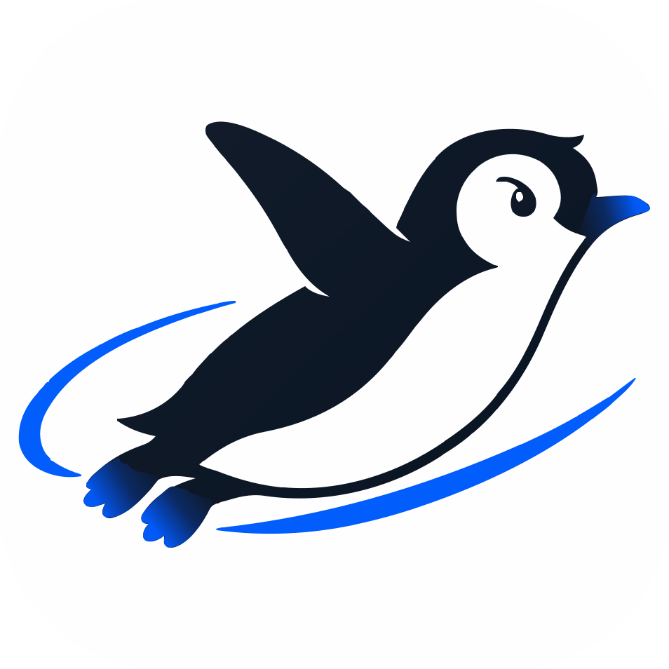

<p align="center">
  
</p>

<h1 align="center">PenguinHarness</h1>

<p align="center"><strong>Unified and Stable RSI Framework</strong><br />Fully automatic optimization: <strong>any model&nbsp;· any algorithm&nbsp;· any benchmark</strong></p>

<p align="center">
  <a href="https://penguin.ooo/download">
    <picture>
      <source media="(prefers-color-scheme: dark)" srcset="assets/readme/download-en-dark.svg" />
      
    </picture>
  </a>
</p>

<p align="center">
  <a href="https://www.npmjs.com/package/@prismshadow/penguin-core"></a>
  <a href="https://github.com/Prism-Shadow/penguin-harness/actions/workflows/ci.yml"></a>
  <a href="https://github.com/Prism-Shadow/penguin-harness/actions/workflows/pages.yml"></a>
  <a href="LICENSE"></a>
  = 24" />
</p>

<p align="center">
  <a href="https://penguin.ooo/"></a>
  <a href="https://penguin.ooo/docs/"></a>
  <a href="https://penguin.ooo/blog"></a>
</p>

<p align="center">
  <a href="https://discord.gg/eFHKqqcU3D"></a>
  <a href="https://x.com/code_hiyouga"></a>
  <a href="https://github.com/Prism-Shadow/penguin-harness-community/blob/main/wechat/group.jpg"></a>
</p>

<p align="center">
  <a href="https://www.producthunt.com/products/penguinharness?embed=true&amp;utm_source=badge-featured&amp;utm_medium=badge&amp;utm_campaign=badge-penguinharness" target="_blank" rel="noopener noreferrer"></a>
</p>

<p align="center">English | <a href="README.zh.md">简体中文</a></p>

<p align="center">
  
</p>

## Why PenguinHarness

PenguinHarness is an open-source framework for agent self-evolution (recursive self-improvement, RSI). The model stays fixed; the harness evolves: prompts, Skills, tools and hooks. It runs on your computer or server as a desktop app, a Web App, a CLI and an SDK.

- **Every RSI algorithm in one framework.** Default, OPRO, APE, ACE and AWM ship as plugins and run on the same built-in Benchmarks, scoreboard and snapshots.
- **One sentence builds an agent app.** Describe what you need, and an agent writes the app, its page and its run instructions.
- **Cheap to run.** A deliberately small toolset, tuned for open models: on our data-analysis suite, the best accuracy at 1/70 of Claude Code's cost.

## Self-evolution

Pick an algorithm, pick a Benchmark, and an agent improves another agent round by round. Every candidate is a new version, snapshotted before it changes, and every score lands in the Evaluation Center.

| Toolkit | Algorithm |
| --- | --- |
| `default-rsi-toolkit` | Trial, reflect, improve: one hypothesis and one change per round |
| `opro-rsi-toolkit` | [OPRO](https://arxiv.org/abs/2309.03409): new instructions from the history of scored ones |
| `ape-rsi-toolkit` | [APE](https://arxiv.org/abs/2211.01910): candidate instructions induced from examples |
| `ace-rsi-toolkit` | [ACE](https://arxiv.org/abs/2510.04618): lessons from Traces curated into a playbook |
| `awm-rsi-toolkit` | [AWM](https://arxiv.org/abs/2409.07429): workflows induced from successful runs |

Every new Project includes seven Benchmarks, run as Harbor tasks in Docker: PenguinHarness Benchmark Sec A to Sec E (from rag-bench-essential, DeepSWE, AutomationBench, Terminal-Bench-Science and Terminal-Bench) and GDPevo Train and Test. More are in [penguin-harness-benchmark](https://github.com/Prism-Shadow/penguin-harness-benchmark).

<p align="center">
  
</p>

**Demo:** a decision agent is evaluated, revises its working method once, and is retested on the same model. Its score goes from 84 to 100, and the cost of every run is on screen.

https://github.com/user-attachments/assets/7925b4b5-db78-4e00-b209-89deca394e34

## One sentence, one app

```text
Build a legal review agent with a simple workspace where users upload contracts, track the review, and download a report with risky clauses, explanations, and suggested revisions.
```

The result: a legal review app. Users upload contracts, follow each file's review, and download a report of risky clauses with explanations and suggested revisions. Five sample reviews cost $0.0423 in model calls.

https://github.com/user-attachments/assets/28c0ef95-1dfa-47be-bad0-7326ccdf4e7c

## What agents can do

<table>
  <tr>
    <td width="50%" valign="top">
      <b>Browser automation</b><br />
      Agents drive your own Chrome through the PenguinHarness Browser extension, or the desktop app's built-in browser. They read pages as text and act through short scripts, so a step costs few tokens. <a href="https://penguin.ooo/blog/let-agents-use-the-browser">Tutorial</a><br /><br />
      
    </td>
    <td width="50%" valign="top">
      <b>Workbenches</b><br />
      Every agent can have its own hot-reloaded workbench: ask for one and the agent writes the page and its server code. The workbench appears as a tab beside the agent's chat. <a href="https://penguin.ooo/blog/build-agent-apps-with-workflows">Tutorial</a><br /><br />
      
    </td>
  </tr>
  <tr>
    <td width="50%" valign="top">
      <b>Remote machines</b><br />
      Add a machine the server reaches over ssh. Conversations in a Workspace on that machine run on it, in the same window. <a href="https://penguin.ooo/blog/run-agents-on-remote-machines">Tutorial</a><br /><br />
      
    </td>
    <td width="50%" valign="top">
      <b>Agent API</b><br />
      One unified API connects any agent to any external app: send input over HTTP and read the run back as a stream of AMSP events. <a href="https://penguin.ooo/blog/call-agents-with-the-agent-api">Tutorial</a><br /><br />
      
    </td>
  </tr>
</table>

Replies can also carry UI: choices, forms, steps, Mermaid diagrams and live widgets ([A2UI](https://penguin.ooo/blog/penguinharness-0-2-15)).

## Results

Each harness on the model it is usually paired with, on the same tasks:

<p align="center">
  <picture>
    <source media="(prefers-color-scheme: dark)" srcset="assets/readme/benchmark-dark.svg" />
    
  </picture>
</p>

## Built-in plugins

Agents can also write and optimize their own Skills ([docs](https://penguin.ooo/docs/skills)).

| Category             | Plugins                                                                       |
| -------------------- | ----------------------------------------------------------------------------- |
| Agent Self-Evolution | `default-rsi-toolkit`, `opro-rsi-toolkit`, `ape-rsi-toolkit`, `ace-rsi-toolkit`, `awm-rsi-toolkit` |
| Office Productivity  | `a2ui`, `data-analysis`, `use-firecrawl`, `browser-automation`, `use-bento-slides`, `humanizer`, `goal`, `continual-learning`, `agent-company`, `penguin-support` |
| Software Development | `software-development`, `use-claude-code`                              |
| AI App Development   | `agent-development`, `agent-evaluation`, `model-development`, `skill-porting` |

## Supported models

These are the model families we focus on supporting. The app's **Models** page lists each variant and its providers.

### Closed-source models

| Model | Providers |
| --- | --- |
| GPT 6.1 | OpenAI, OpenRouter |
| Claude 5.5 | Anthropic, OpenRouter, OpenCode Go |
| Gemini 4 | Google Gemini, OpenRouter, Penguin Go, OpenCode Go |
| Grok 4.7 | OpenRouter, OpenCode Go |
| Qwen3.8 Max | Qwen Token Plan, Qwen Pay-As-You-Go, OpenRouter, TokenDance, OpenCode Go |

### Open-source models

| Model | Providers |
| --- | --- |
| DeepSeek V4.1 | DeepSeek, OpenRouter, Fireworks AI, Atlas Cloud, TokenDance, Penguin Go, OpenCode Go, Qwen Token Plan, Qwen Pay-As-You-Go, ModelScope |
| Kimi K3 | Moonshot AI, OpenRouter, Fireworks AI, TokenDance, OpenCode Go, Qwen Pay-As-You-Go |
| GLM 5.3 | Z.AI, OpenRouter, TokenDance, OpenCode Go |
| Hunyuan 4 | OpenRouter, TokenDance, OpenCode Go |
| MiMo v2.6 | OpenRouter, TokenDance, OpenCode Go |

OpenCode Go offers Claude Haiku 5.5; Fable 5.1, Opus 5.5 and Sonnet 5.5 are available through Anthropic and OpenRouter. Hunyuan 4 uses `hy4-preview`.

Custom OpenAI-protocol endpoints also work, covering 1000+ online and local models.

## Install

### Desktop app

Download the installer from [penguin.ooo/download](https://penguin.ooo/download): macOS 11+ (dmg), Windows 10+ (exe) or Linux x64 (AppImage, deb). The app opens signed in and needs no terminal.

### CLI and server

| Platform | Install command |
| --- | --- |
| Linux / macOS | `curl -fsSL https://penguin.ooo/install.sh \| sh` |
| Windows (PowerShell) | `irm https://penguin.ooo/install.ps1 \| iex` |
| npm (Node >= 24) | `npm install -g @prismshadow/penguin-cli` |

Then run `penguin web`. It serves the Web App at `http://127.0.0.1:7364` and prints a first-login link until a password is set; models are configured on the **Models** page. The desktop app and the CLI share `~/.penguin/data`.

### Docker

```bash
docker run -d --name penguin -p 127.0.0.1:7364:7364 -v penguin-data:/data hiyouga/penguinharness:0.2.17
docker logs penguin       # the first-login link, openable as it stands on this machine
```

The image serves on port 7364 with its data on the `/data` volume, for `linux/amd64` and `linux/arm64`; `latest` follows changes to the image's runtime or build inputs on `main`, and each release is also tagged with its version. The example listens on loopback only. For a network-facing deployment, Compose and upgrades, see the [Docker quickstart](https://penguin.ooo/docs/quickstart-docker).

<details>
<summary><b>Offline install (air-gapped machines)</b></summary>

Every <a href="https://github.com/Prism-Shadow/penguin-harness/releases">GitHub Release</a> attaches exactly one package per target — Linux and macOS in x64 / arm64, Windows in x64, plus a runtime-less universal package. The same file serves online and offline installation. Each package seals the program payload, its SHA256 checksum and the platform's installer. Download the one file on a networked machine, copy it to the target, extract once and run the bundled installer — no network, no separate checksum file to carry (the sealed SHA256 is always verified).

**Linux (on arm64, use `penguin-linux-arm64.tar.gz`):**

```bash
mkdir penguin-install
tar -xzf penguin-linux-x64.tar.gz -C penguin-install
./penguin-install/install.sh
```

**macOS (Apple silicon shown; on Intel, use `penguin-darwin-x64.tar.gz`):**

```bash
mkdir penguin-install
tar -xzf penguin-darwin-arm64.tar.gz -C penguin-install
./penguin-install/install.sh
```

**Windows (unzip, then double-click `install.cmd` — or run it in PowerShell):**

```powershell
Expand-Archive penguin-win32-x64.zip -DestinationPath penguin-install
cd penguin-install
.\install.cmd
```

</details>

### Chrome extension (optional)

[PenguinHarness Browser](https://chromewebstore.google.com/detail/penguinharness-browser/dodgfhpcbmkjfcbgnoidablfgjjhhmgp) lets agents drive the tabs you hand them in your own Chrome.

## CLI and SDK

The same engine, scriptable, and made to be driven by agents:

```bash
penguin config model add --provider deepseek --model-id deepseek-flash --api-key sk-... --set-default
penguin run -m "Create hello.txt containing Hello, Penguin"   # one-shot task
penguin chat       # interactive REPL (/compact, /clear, /exit, Ctrl-C to interrupt)
penguin server     # headless service (same API the Web App uses)
```

```ts
import { createAgent, isCompleteModelMessage, userText } from "@prismshadow/penguin-core";

const agent = await createAgent({ agentId: "default_agent" });
const session = await agent.createSession({ workspaceDir: process.cwd() });

for await (const output of session.run([userText("Create hello.txt containing hi")], {
  approve: async () => "allow", // per-tool-call approval
})) {
  if (isCompleteModelMessage(output) && output.payload.type === "text") {
    console.log(output.payload.text);
  }
}
```

## Roadmap

- [x] Public release of the benchmark suite
- [x] Desktop app
- [x] Windows support
- [x] Agent company and templates
- [ ] Company-level self-evolution
- [ ] OpenShell integration (permission-governed shell)
- More to come…

## Development

```bash
pnpm install && pnpm build   # build first: core's exports point at dist/
pnpm dev                     # backend + web app together (prefixed logs, deps built once)
```

Working on this repository with a coding agent: its development Skills are in `.agents/skills/` (`penguin-harness-dev`, `penguin-harness-frontend`, `penguin-harness-manual-test`, `penguin-harness-writing`). Claude Code loads them with no install, through the `.claude` → `.agents` symlink; for another agent, link or copy `.agents/skills/*` into the directory it reads Skills from.

See [CONTRIBUTING.md](.github/CONTRIBUTING.md) for the full workspace guide: dev commands, quality gates, repo layout, and the changelog rule.

## Contributors

Thanks to everyone who has contributed to PenguinHarness!

<p align="center">
  <a href="https://github.com/Prism-Shadow/penguin-harness/graphs/contributors"></a>
</p>

## Citation

If you use PenguinHarness in your research, please cite:

```bibtex
@software{penguinharness2026,
  author  = {{PrismShadow Team}},
  title   = {PenguinHarness: Efficient Self-Improving Harness for Everyone},
  year    = {2026},
  url     = {https://github.com/Prism-Shadow/penguin-harness},
  license = {Apache-2.0}
}
```

## Acknowledgements

This repo benefits from:

- [MinGit](https://github.com/git-for-windows/git): the POSIX shell and Git bundled on Windows
- [GenericAgent](https://github.com/lsdefine/genericagent): built-in browser automation

See [THIRD-PARTY-NOTICES.md](THIRD-PARTY-NOTICES.md) for their licenses.

## License

[Apache-2.0](LICENSE) © 2026 Prism Shadow

## Maintenance team

**Organizations:** PrismShadow AI, Qinghe Dynamic

**Maintainers:**

- Yaowei Zheng (LlamaFactory, PrismShadow)
- Yangxi Xiang
- Junhao Hu
- Leijun Zhou (PrismShadow)
- Zhihao Liu (PrismShadow)
- Xiang Qu (PrismShadow)
- Hengjin Dou (PrismShadow)
- Ning Wang (Qinghe Dynamic)
- Ming Lu (Qinghe Dynamic)

Built with ❤️
