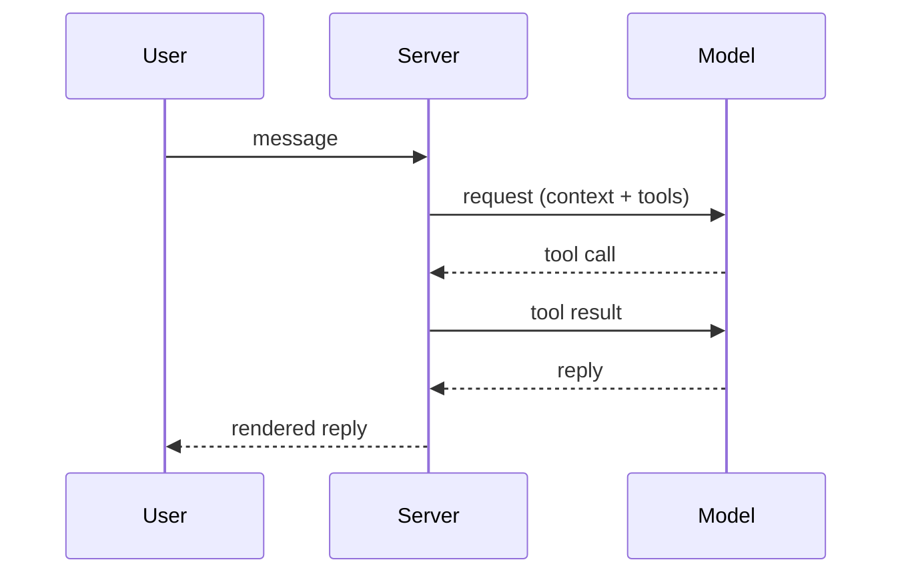
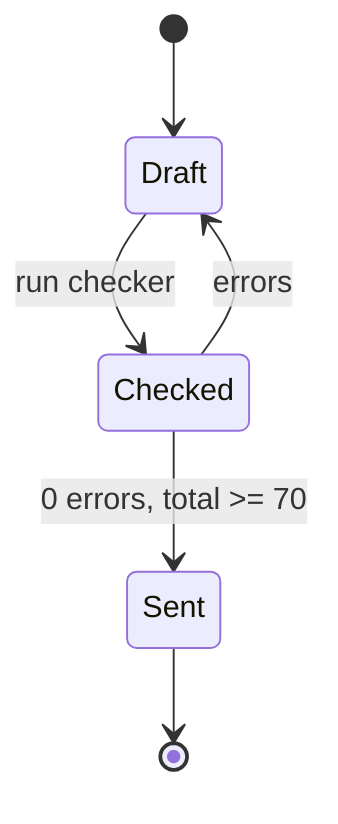

# A2UI component reference

Every component the client can render, field by field, with a valid example and the mistakes the checker rejects. The limits here are the checker's: over a limit is an **error** (the block will not render), past a "warn" mark is a **warning** (the block renders, the reader has more to take in). The grammar lives in `@prismshadow/penguin-core/a2ui`; this file and the checker are generated from the same rules, so what passes here renders.

## The fence

```` ```a2ui ```` (or ```` ```a2ui json ````, or `~~~a2ui`) holding exactly ONE JSON object. Strict JSON: double quotes, no comments, no trailing commas (a trailing comma is tolerated once with a warning). The fence must be closed. An unknown `type` is an error; an unknown field inside a known type is ignored with a warning, so a newer block still renders on an older client.

A fence nested inside a longer fence (four backticks around a `markdown` example) is an example, not a block.

## choice

One question, 2–7 options; the user picks one (or several with `multiple`), the pick fills the composer and the user sends it. A choice ends the reply.

| Field | Type | Rule |
| --- | --- | --- |
| `type` | `"choice"` | required |
| `id` | string | optional, `^[a-z][a-z0-9_-]{0,31}$` |
| `question` | string | required, ≤ 120 characters |
| `options` | array of option | required, 2–7 (warn > 5) |
| `options[].label` | string | required, ≤ 60 (warn > 40), unique within the block |
| `options[].value` | string | optional, ≤ 500; what the pick fills (default: the label) |
| `options[].description` | string | optional, ≤ 160 |
| `options[].recommended` | boolean | optional; at most ONE option may carry `true` |
| `multiple` | boolean | optional; several picks, joined with 、 (zh) or ", " (en) |
| `allowOther` | boolean | optional; adds an "Other…" control that clears the composer and focuses it |

```a2ui
{
  "type": "choice",
  "id": "deploy-target",
  "question": "Where should the first deployment go?",
  "options": [
    { "label": "Staging", "value": "Deploy to staging first", "description": "Same config as production, no users.", "recommended": true },
    { "label": "Production", "value": "Deploy straight to production", "description": "Only if the change is already verified." },
    { "label": "Local only", "description": "Build and test here, deploy later." }
  ],
  "allowOther": true
}
```

Fill text when the user picks Staging: `Deploy to staging first`. Use `value` to turn a short label into the sentence you want to read back.

Common mistakes: two options with the same label (`duplicate_label`); `"recommended": true` on two options (`multiple_recommended`); a single option (`count_out_of_range` — ask a plain question instead); eight options (`count_out_of_range` — group them, or ask in two turns); a 70-character label (`too_long` — move the detail into `description`); prose after the block (`interactive_not_last`).

## form

Several questions answered at once, 1–6 fields. Each field is one control, named by its `kind`. The answers fill the composer as one line per field, `label: answer` (en) / `label：answer` (zh), in the form's order; a field left empty fills no line. A form ends the reply.

The fill button stays off until every required field is answered and every answer keeps its field's rule. While an answer breaks its rule, the control turns to the danger colour and the line under it shows the field's `hint`, or the rule in symbols (`1–10`, `≤ 500`, `YYYY-MM-DD`) when there is no hint. A required field left empty shows only its asterisk.

| Field | Type | Rule |
| --- | --- | --- |
| `type` | `"form"` | required |
| `id` | string | optional, `^[a-z][a-z0-9_-]{0,31}$` |
| `title` | string | optional, ≤ 80 |
| `fields` | array of field | required, 1–6 (warn > 4) |
| `fields[].id` | string | required, `^[a-z][a-z0-9_]{0,31}$`, unique within the form |
| `fields[].label` | string | required, ≤ 60 |
| `fields[].kind` | one of the kinds below | required |
| `fields[].hint` | string | optional, ≤ 80; the line under the control: a format, a convention, the unit. It is also the error line while the answer breaks the field's rule |
| `fields[].required` | boolean | optional; a switch and a slider always hold an answer |
| `fields[].options` | array of option | single and multiple 2–7 (warn > 5), select 2–30 (warn > 12); the same rules as a choice's. Required for these three kinds, not allowed for the others. A select ignores `description` |
| `fields[].placeholder` | string | optional, ≤ 80; text, textarea, number, and select (the words of its empty row); ignored elsewhere with a warning |
| `fields[].min` / `max` | number | number and slider; `min < max`; a slider needs both |
| `fields[].step` | number | number and slider; `> 0`, default 1 |
| `fields[].unit` | string | number and slider, ≤ 12 |
| `fields[].maxLength` | integer | text 1–500, textarea 1–2000; default the ceiling |
| `fields[].pattern` | string | text only, ≤ 120: a JavaScript regular expression, without slashes or flags, that the whole answer must match. Say the format in `hint` |
| `fields[].default` | by kind | optional; the answer the field starts with. It must keep the field's own rule |
| `submitLabel` | string | optional, ≤ 24 |

The kinds:

| `kind` | The control | Answer and `default` | Fill line |
| --- | --- | --- | --- |
| `text` | one line | a string | `Branch: main` |
| `textarea` | several lines | a string | one line as `Notes: text`; several lines as `Notes:`, then each line indented two spaces |
| `number` | a number box with − and +, the unit inside | a number in range | `Pods: 3 pods` |
| `slider` | a slider with its value beside it | a number in range; without a default it starts at `min` | `Temperature: 0.7`, with the unit if any; always filled |
| `single` | 2–7 options, one pick | one option label | the option's `value` (default its label) |
| `multiple` | 2–7 options, several picks | a list of option labels | the values joined with ", " / 、 |
| `select` | a dropdown of 2–30 options | one option label | the option's `value` |
| `switch` | on or off | `true` or `false`; without a default it starts off | `Yes` / `No` (是 / 否); always filled |
| `date` | a date picker | `"YYYY-MM-DD"` | `First run: 2026-10-21` |
| `time` | a time picker | `"HH:mm"`, 24-hour | `Start: 09:30` |
| `datetime` | a date and time picker | `"YYYY-MM-DDTHH:mm"` | `First run: 2026-10-21 02:00` |

Pick the kind by the answer. Use `single` for a few options the reader compares, and `select` for a long list they look up, such as a region or a language. Use `number` when the exact figure matters, and `slider` for a position in a known range. A switch and a slider always hold a value, so they always fill a line; when "not answered" must stay possible, ask with a `single`. Never ask for a password or a key in a form: the answer lands in the conversation as text. A file is not a field either; the composer takes attachments itself.

```a2ui
{
  "type": "form",
  "title": "Benchmark size",
  "fields": [
    { "id": "cases", "label": "Number of cases", "kind": "number", "min": 5, "max": 100, "step": 5, "default": 20, "required": true },
    { "id": "budget", "label": "Budget per run", "kind": "number", "min": 1, "unit": "USD", "placeholder": "10" },
    {
      "id": "focus",
      "label": "What matters most",
      "kind": "single",
      "options": [{ "label": "Accuracy" }, { "label": "Speed" }, { "label": "Cost" }],
      "required": true
    },
    { "id": "notes", "label": "Anything else", "kind": "textarea", "placeholder": "Constraints, deadlines", "maxLength": 500 }
  ],
  "submitLabel": "Use these"
}
```

Fill text when `cases` stays at 20, `budget` is 5 and `focus` is Speed:

```text
Number of cases: 20
Budget per run: 5 USD
What matters most: Speed
```

```a2ui
{
  "type": "form",
  "title": "Nightly evaluation",
  "fields": [
    { "id": "branch", "label": "Branch", "kind": "text", "pattern": "[A-Za-z0-9._/-]+", "hint": "A branch name, such as main", "default": "main" },
    {
      "id": "region",
      "label": "Region",
      "kind": "select",
      "placeholder": "Choose a region",
      "options": [{ "label": "Frankfurt" }, { "label": "Virginia" }, { "label": "Singapore" }, { "label": "Tokyo" }, { "label": "São Paulo" }],
      "required": true
    },
    { "id": "start", "label": "First run", "kind": "datetime", "default": "2026-10-21T02:00" },
    { "id": "notify", "label": "Notify me when it ends", "kind": "switch", "default": true }
  ]
}
```

Fill text when the user picks Tokyo and leaves the rest:

```text
Branch: main
Region: Tokyo
First run: 2026-10-21 02:00
Notify me when it ends: Yes
```

Common mistakes: `options` on a `text` field (`options_forbidden`); a `select` without `options` (`options_required`); `min` or `unit` on a `text` field, `maxLength` on a `number`, `pattern` on a `textarea` (`not_for_kind`); a slider without `min` or `max` (`missing_field`); `min` not below `max` (`range_invalid`); a `pattern` that does not compile (`invalid_format`); a `default` that breaks its field's rule, such as a number out of range, a label that is not an option, `"2026-02-30"`, or `"yes"` on a switch (`default_invalid`); two fields with the same `id` (`duplicate_id`); an `id` with a hyphen or a capital (`invalid_format`); seven fields (`count_out_of_range` — split into two turns); eight options on a `single` (`count_out_of_range` — use a `select`).

## steps

A procedure the user performs, 1–15 steps, one instruction per step. A `warning` (irreversible loss, security, harm) or a `caution` (something recoverable breaks) is rendered ABOVE its step, as STE requires; a `note` (useful information) below it. `code` is one command or snippet for that step.

| Field | Type | Rule |
| --- | --- | --- |
| `type` | `"steps"` | required |
| `title` | string | optional, ≤ 80 |
| `steps` | array of step | required, 1–15 (warn > 10) |
| `steps[].text` | string | required, ≤ 200; the instruction, imperative |
| `steps[].warning` | string | optional, ≤ 200 |
| `steps[].caution` | string | optional, ≤ 200 |
| `steps[].note` | string | optional, ≤ 200 |
| `steps[].code` | string | optional, ≤ 2000 |
| `steps[].lang` | string | optional, ≤ 20; only with `code` |

```a2ui
{
  "type": "steps",
  "title": "Rotate the API key",
  "steps": [
    { "text": "Create the new key in the provider console and copy it." },
    {
      "caution": "Running sessions keep the old key until they restart.",
      "text": "Store the new key in the Vault under the same name.",
      "code": "penguin config set-key openai sk-...",
      "lang": "sh"
    },
    { "text": "Send one test request and confirm it succeeds.", "code": "penguin models test openai", "lang": "sh" },
    {
      "warning": "Deleting the old key logs out every client that still uses it.",
      "text": "Delete the old key in the provider console.",
      "note": "Keep the console open for 10 minutes in case a client still fails."
    }
  ]
}
```

Common mistakes: two instructions in one `text` ("Stop the service and delete the directory" — two steps); a warning written after the harmful step (put it in that step's `warning`); a `lang` without `code` (`ignored_field`); 20 steps (`count_out_of_range` — split the procedure).

## callout

One thing the reader must not miss. Four tones, each with a fixed meaning: `warning` for irreversible loss, security or harm; `caution` for something recoverable that may break; `tip` for a better way; `note` for information worth setting apart. Not a replacement for an ordinary paragraph.

| Field | Type | Rule |
| --- | --- | --- |
| `type` | `"callout"` | required |
| `tone` | `"note"` / `"tip"` / `"caution"` / `"warning"` | required |
| `title` | string | optional, ≤ 80 |
| `text` | string | required, ≤ 400 |

```a2ui
{
  "type": "callout",
  "tone": "warning",
  "title": "This deletes data",
  "text": "The reset removes every Session under this Project. Export the Traces you want to keep before you continue."
}
```

Common mistakes: a tone outside the four (`invalid_enum`); a 600-character text (`too_long` — a callout is one point, not a section); a callout around an ordinary sentence (the rubric's first question).

## mermaid

A ```` ```mermaid ```` fence, not JSON. The first non-comment line names the diagram: one of `flowchart`, `graph`, `sequenceDiagram`, `stateDiagram`, `stateDiagram-v2`, `classDiagram`, `erDiagram`, `gantt`, `journey`, `pie`, `mindmap`, `timeline`, `gitGraph`, `quadrantChart`, `xychart-beta`, `requirementDiagram`, `C4Context`. The app sets the theme and the security level; the diagram carries no configuration:

- no `%%{init: …}%%` directive and no YAML frontmatter key other than `title` (`mermaid_directive`);
- no `click`, `link`, `callback`, `href`, `javascript:` or `<script` (`mermaid_forbidden`) — describe the target in the prose;
- brackets and quotes balanced on every line of a flowchart, state, class or ER diagram (`mermaid_unbalanced`): a label with parentheses or brackets must be quoted, `A["Run (dry)"]`;
- more than 30 nodes or edges, or 400 lines, is a warning (`mermaid_too_big`): split it, or show the main path only.





## Chart data model

The charts share one data model. Every kind but the gauge draws `series` over `categories`:

- `categories`: the x labels (line, area, bar) or the slice names (pie), 1–60 non-empty strings of ≤ 40 characters (warn > 24). A pie has 2–8 slices (warn > 6), each named once.
- `series`: 1–6 (warn > 4), each `{ "label", "values" }`. The `label` is ≤ 40 and unique. `values` holds ONE number per category, in order, and `null` for a missing reading (a gap in the line). A pie and a histogram take exactly one series, with no `null` and nothing below 0.
- A histogram puts `edges` in place of `categories`: n + 1 bin edges, strictly ascending, 3–61 of them. Its one series holds the n counts.
- A scatter puts `points` in place of `values`: `[x, y]` pairs, 1–500 per series (warn > 200).
- Units go on the axes, never into the numbers. `yUnit` (≤ 12) follows every value: `"ms"`, `"%"`, `"GB"`; on a pie it is the slices' unit. `xUnit` belongs to a numeric x axis (scatter, histogram). `xLabel` and `yLabel` (≤ 24) name the axes: `"Day"`, `"Latency"`.
- `min` and `max` fix the value axis (default: from 0 to a round number above the data). `decimals` is 0–3.

## chart

One basic chart drawn from data you have: a tool result, a file, or numbers the user gave. Pick the kind by the question:

- `line`: how a value moved over time. `area` is the same, filled; with `stacked`, the parts of a total over time.
- `bar`: values side by side. `stacked` shows the parts of each total; `horizontal` suits long names or a ranking.
- `pie`: the shares of one whole, at most 6 slices. `donut` draws a ring.
- `scatter`: how two measures relate, one point per observation.
- `histogram`: how values spread over ranges.
- `gauge`: one reading against its whole, with thresholds. Several readings are a `metrics` block.

| Field | Type | Rule |
| --- | --- | --- |
| `type` | `"chart"` | required |
| `kind` | `"line"` / `"area"` / `"bar"` / `"pie"` / `"scatter"` / `"histogram"` / `"gauge"` | required |
| `title` | string | optional, ≤ 60 |
| `categories` | array of string | required for line, area, bar and pie |
| `edges` | array of number | required for histogram |
| `series` | array of series | required for every kind but gauge |
| `xLabel` / `yLabel` | string | optional, ≤ 24; not on a pie |
| `xUnit` | string | optional, ≤ 12; scatter and histogram only |
| `yUnit` | string | optional, ≤ 12 |
| `stacked` | boolean | bar and area; the series add up, so no value is below 0 |
| `horizontal` | boolean | bar only |
| `donut` | boolean | pie only |
| `min` / `max` | number | optional, `min < max`; not on a pie |
| `decimals` | integer | optional, 0–3 |
| `item` | metric | required for gauge: ONE `metrics` item, with the same fields and rules |
| `asOf` | string | optional; a chart need not be a snapshot |

A field the kind does not read is ignored with a warning (`ignored_field`), such as `stacked` on a line or `series` on a gauge.

```a2ui
{
  "type": "chart",
  "kind": "bar",
  "title": "Build minutes per team",
  "categories": ["Web", "Server", "CLI", "Desktop"],
  "series": [
    { "label": "September", "values": [380, 540, 120, 210] },
    { "label": "October", "values": [420, 610, 95, 230] }
  ],
  "yLabel": "Build time",
  "yUnit": "min"
}
```

```a2ui
{
  "type": "chart",
  "kind": "line",
  "title": "p95 latency, last 6 hours",
  "categories": ["09:00", "10:00", "11:00", "12:00", "13:00", "14:00"],
  "series": [{ "label": "p95", "values": [182, 190, 240, null, 205, 198] }],
  "yLabel": "Latency",
  "yUnit": "ms",
  "asOf": "2026-10-06T14:05+08:00"
}
```

```a2ui
{
  "type": "chart",
  "kind": "pie",
  "title": "Disk use by folder",
  "categories": ["node_modules", "Traces", "Caches", "Other"],
  "series": [{ "label": "Size", "values": [12.4, 6.1, 2.3, 1.2] }],
  "yUnit": "GB",
  "decimals": 1,
  "donut": true
}
```

The other kinds change a few fields. An `area` is a line with `"stacked": true` for the parts of a total. A `scatter` gives each series `"points": [[1.2, 120], [3.4, 180]]` in place of `values`. A `histogram` gives `"edges": [0, 100, 200, 500]` in place of `categories`, and one series of 3 counts. A `gauge` gives `"item": { "label": "Disk", "kind": "used", "value": 320, "max": 512, "unit": "GB", "warn": 435, "danger": 486 }` and no series.

As text, a bar or line chart becomes one bullet per category with every series' value (`- Web: September 380 min · October 420 min`), or one line per series past 20 categories (`- p95: 182 → 198 ms (min 175, max 240, 30 points)`). A pie becomes one bullet per slice with its share (`- node_modules: 12.4 GB (56%)`), and a gauge its metrics line.

Common mistakes: a series with one value too few (`length_mismatch`; write `null` where a reading is missing); a unit inside the numbers, `"120ms"` (`wrong_type`; write `120` and `"yUnit": "ms"`); nine slices (`count_out_of_range`; merge the small ones into "Other"); two series on a pie (`count_out_of_range`; compare them with a bar chart); a negative value in a stacked chart, or bin edges that do not go up (`range_invalid`); `stacked` on a line (`ignored_field`; use `area`); a gauge with `value` and `max` at the top instead of in `item` (`missing_field`).

## weather

Built from: a line chart of the next hours and a range bar per day; the condition art and the details are its own.

The conditions at one place now, optionally with the next hours and the coming days. A snapshot: it shows the time in `asOf` and never updates. The Web App draws a line illustration of the condition that moves (rain falls, clouds drift) and stays still under reduced motion. Take the data from `scripts/weather.mjs`, never from memory. The script reads Open-Meteo and falls back to wttr.in when Open-Meteo fails; `source` names the one that answered.

| Field | Type | Rule |
| --- | --- | --- |
| `type` | `"weather"` | required |
| `place` | string | required, ≤ 60 |
| `condition` | condition | required; one of `clear`, `partly-cloudy`, `cloudy`, `fog`, `drizzle`, `rain`, `heavy-rain`, `thunder`, `snow`, `sleet`, `wind` |
| `temp` | number | required |
| `unit` | `"C"` / `"F"` | optional, default `"C"`; applies to every temperature in the block |
| `night` | boolean | optional; draws the moon for `clear` and `partly-cloudy` |
| `summary` | string | optional, ≤ 80; one line in your words |
| `high` / `low` | number | optional; `high ≥ low` |
| `feelsLike` | number | optional |
| `humidity` | number | optional, 0–100 |
| `windSpeed` | number | optional, ≥ 0 |
| `windUnit` | `"km/h"` / `"m/s"` / `"mph"` | optional, default `"km/h"`; only with `windSpeed` |
| `windDirection` | string | optional, ≤ 6 (`"NE"`, `"东北"`); only with `windSpeed` |
| `hourly` | array of hour | optional, 2–24 (warn > 12) |
| `hourly[].time` | string | required, `"HH:mm"` (24 h) or an ISO date-time |
| `hourly[].temp` | number | required |
| `hourly[].condition` | condition | optional |
| `hourly[].precip` | number | optional, chance of precipitation 0–100 |
| `hourly[].night` | boolean | optional; the night drawing for that hour |
| `daily` | array of day | optional, 2–7 |
| `daily[].date` | string | required, `"YYYY-MM-DD"` |
| `daily[].high` / `low` | number | required; `high ≥ low` |
| `daily[].condition` | condition | required |
| `daily[].precip` | number | optional, 0–100 |
| `asOf` | string | optional, an ISO 8601 date-time; without it the checker warns (`no_as_of`) |
| `source` | string | optional, ≤ 40, e.g. `"Open-Meteo"` or `"wttr.in"` |

```a2ui
{
  "type": "weather",
  "place": "Beijing",
  "condition": "partly-cloudy",
  "temp": 18,
  "unit": "C",
  "high": 22,
  "low": 12,
  "feelsLike": 17,
  "humidity": 62,
  "windSpeed": 12,
  "windUnit": "km/h",
  "windDirection": "NE",
  "hourly": [
    { "time": "14:00", "temp": 18, "condition": "partly-cloudy", "precip": 10 },
    { "time": "15:00", "temp": 19, "condition": "partly-cloudy", "precip": 10 },
    { "time": "16:00", "temp": 19, "condition": "cloudy", "precip": 20 },
    { "time": "17:00", "temp": 18, "condition": "cloudy", "precip": 20 }
  ],
  "daily": [
    { "date": "2026-10-06", "high": 22, "low": 12, "condition": "partly-cloudy", "precip": 20 },
    { "date": "2026-10-07", "high": 19, "low": 11, "condition": "rain", "precip": 80 }
  ],
  "asOf": "2026-10-06T14:05+08:00",
  "source": "Open-Meteo"
}
```

As text, made the same afternoon in Beijing time:

```text
**Beijing · Partly cloudy 18°C**

H 22° / L 12° · Feels like 17° · Humidity 62% · Wind 12 km/h NE

Next hours: 14:00 18° · 15:00 19° · 16:00 19° · 17:00 18°

Next days:
- Today Partly cloudy 22° / 12° · 20%
- Wed Rain 19° / 11° · 80%

As of 14:05 · Source: Open-Meteo
```

Common mistakes: a forecast written from memory (the rubric's seventh question; run the script); no `asOf` (`no_as_of`) or one that does not parse (`invalid_datetime`); `"time": "2pm"` (`invalid_format`; write `"14:00"`); `"condition": "sunny"` (`invalid_enum`; write `"clear"`); `high` below `low` (`range_invalid`); `"humidity": 120` (`range_invalid`); `windDirection` without `windSpeed` (`ignored_field`); 24 hourly entries (`weather_hourly_long`; the script keeps every second hour past 12).

## clock

The time now, in one to four time zones. Live: the Web App ticks it every second, so the block carries no time at all, only the zones.

| Field | Type | Rule |
| --- | --- | --- |
| `type` | `"clock"` | required |
| `title` | string | optional, ≤ 40 |
| `zones` | array of zone | optional, 1–4; default: the viewer's local time |
| `zones[].zone` | string | required, ≤ 64; an IANA name (`"Asia/Shanghai"`, `"America/New_York"`) or `"local"` |
| `zones[].label` | string | optional, ≤ 24 (`"Beijing"`, `"北京"`) |
| `style` | `"digital"` / `"analog"` / `"both"` | optional, default `"digital"` |
| `hourCycle` | `"12"` / `"24"` / `"auto"` | optional, default `"auto"` (the interface language decides) |
| `seconds` | boolean | optional, default false; the digital time shows seconds |
| `date` | boolean | optional, default true; the weekday and the date under the time |

```a2ui
{
  "type": "clock",
  "title": "Stand-up at 09:30 Beijing time",
  "zones": [
    { "zone": "Asia/Shanghai", "label": "Beijing" },
    { "zone": "Europe/London", "label": "London" },
    { "zone": "America/New_York", "label": "New York" }
  ],
  "hourCycle": "24"
}
```

As text, one line per zone with the time at which the text was made:

```text
**Stand-up at 09:30 Beijing time**

- Beijing: 14:05 (Tue, Asia/Shanghai)
- London: 07:05 (Tue, Europe/London)
- New York: 02:05 (Tue, America/New_York)
```

Common mistakes: a city or a time zone's common name as `zone` (`"Beijing"`, `"China Standard Time"`: `invalid_timezone`; write `"Asia/Shanghai"`); the same zone twice (`duplicate_zone`); five zones (`count_out_of_range`); the current time written into `title` (it is wrong a minute later; the clock already shows it).

## countdown

The time left until one instant. Live: the Web App counts down every second and shows `doneLabel` once the instant passes.

| Field | Type | Rule |
| --- | --- | --- |
| `type` | `"countdown"` | required |
| `to` | string | required; an ISO 8601 date-time (`"2026-10-09T18:00+08:00"`) or `"YYYY-MM-DD"` (midnight, the viewer's local time) |
| `label` | string | required, ≤ 60; what happens then |
| `doneLabel` | string | optional, ≤ 60; shown once the instant passes (default: "Time's up") |
| `showTarget` | boolean | optional, default true; the target date and time under the figure |

Write the offset in `to` when the instant belongs to a place: "18:00 Beijing time" is `+08:00`. Without an offset, every viewer counts down to 18:00 on their own clock.

```a2ui
{
  "type": "countdown",
  "to": "2026-10-09T18:00+08:00",
  "label": "Launch deadline",
  "doneLabel": "Launch window open"
}
```

As text, made at 14:05 Beijing time on 2026-10-06: `**Launch deadline**: 3 days 3 hours left (2026-10-09 18:00)`; once the instant has passed, `**Launch deadline**: Launch window open (2026-10-09 18:00)`.

Common mistakes: `"to": "next Friday"` or `"2026/10/09"` (`invalid_datetime`); a label that says when instead of what (`"Oct 9"`; the target is shown already); a countdown to an instant that has passed (say it in prose).

## metrics

Built from: gauge tiles. Each item is exactly a `gauge` chart's `item`, with the same fields and rules.

A dashboard of one to eight readings, one tile each: a quota or budget left, the progress of a job, figures with their change. `kind` says how to read each tile. Put the readings of one moment in one block, never one block per number. A machine snapshot is a `resources` block.

| Field | Type | Rule |
| --- | --- | --- |
| `type` | `"metrics"` | required |
| `title` | string | optional, ≤ 40 |
| `items` | array of metric | required, 1–8 (warn > 6) |
| `asOf` | string | optional, an ISO 8601 date-time; without it the checker warns (`no_as_of`) |
| `items[].label` | string | required, ≤ 40, unique within the block |
| `items[].value` | number | required |
| `items[].kind` | `"reading"` / `"used"` / `"remaining"` / `"progress"` | optional, default `"reading"` |
| `items[].max` | number | the whole; required for `used`, `remaining` and `progress`, and for a `ring` or `bar` gauge |
| `items[].min` | number | optional, default 0; `min < max` |
| `items[].gauge` | `"ring"` / `"bar"` / `"none"` | optional; default `bar` for `progress`, `ring` when `max` is given, else `none` |
| `items[].unit` | string | optional, ≤ 12, after the number (`"%"`, `"GB"`, `"ms"`) |
| `items[].prefix` | string | optional, ≤ 4, before the number (`"¥"`, `"$"`) |
| `items[].decimals` | integer | optional, 0–3; default 0 for a whole number, else up to 2 |
| `items[].worse` | `"high"` / `"low"` | optional, which way is bad; default `low` for `remaining`, else `high` |
| `items[].warn` / `danger` | number | optional, in the value's unit, read along `worse` |
| `items[].detail` | string | optional, ≤ 60; one quiet line under the value (default from `kind`, e.g. "320 / 512 GB used") |
| `items[].delta` | number | optional; the change since the previous reading, in the same unit |
| `items[].deltaLabel` | string | optional, ≤ 24 (`"vs. yesterday"`); only with `delta` |
| `items[].history` | array of number | optional, 2–60 points, oldest first; draws a sparkline |

The four kinds:

- `reading` — a measurement: CPU 37 %, load 1.2, latency 120 ms.
- `used` — the part of a whole already consumed: disk 320 of 512 GB.
- `remaining` — the part of a whole still left: a quota of 1,240 of 5,000, a budget of ¥320 of ¥1,000.
- `progress` — how far a job got: upload 63 %, 7 of 12 tasks. At `value ≥ max` the tile shows done.

Thresholds: past `warn` the tile takes the attention colour, past `danger` the danger colour. With `worse: "high"` (the default) they read upward, so `warn ≤ danger`: CPU `warn: 80, danger: 95`. With `worse: "low"` they read downward, so `warn ≥ danger`: `warn: 1000, danger: 250` on a 5,000 quota.

```a2ui
{
  "type": "metrics",
  "title": "Release 0.3",
  "items": [
    { "label": "API quota", "kind": "remaining", "value": 1240, "max": 5000, "warn": 1000, "danger": 250, "detail": "Resets in 3 days" },
    { "label": "Budget", "kind": "remaining", "value": 180, "max": 1000, "prefix": "¥", "warn": 200, "danger": 50, "delta": -60, "deltaLabel": "today" },
    { "label": "Test runs", "kind": "progress", "value": 7, "max": 12, "unit": "runs", "history": [2, 3, 5, 7] },
    { "label": "p95 latency", "value": 182, "unit": "ms", "warn": 250, "danger": 400, "delta": -14, "deltaLabel": "vs. yesterday" }
  ],
  "asOf": "2026-10-06T14:05+08:00"
}
```

As text, the title, one bullet per tile and the `asOf` time. The budget tile reads `- Budget: ¥180 — ¥180 / ¥1,000 left (−¥60 today) — warning`: its value, the detail, the change, and a mark for the colour (warning, critical or done).

Common mistakes: `"kind": "remaining"` or `"gauge": "ring"` without `max` (`missing_field`); thresholds against `worse`, such as `warn: 250, danger: 1000` on a `remaining` tile (`range_invalid`; swap them, or set `worse`); `min` not below `max` (`range_invalid`); `"decimals": 5` (`range_invalid`); two tiles with one label (`duplicate_label`); `deltaLabel` without `delta` (`ignored_field`); seven tiles (`metrics_too_many`) or nine (`count_out_of_range`); numbers from memory or an estimate (the rubric's seventh question).

## resources

Built from: a gauge tile per reading (as in `metrics`), a horizontal bar chart for the disks, a line chart for the network.

A snapshot of one machine. Take it from `scripts/sysinfo.mjs`, never from memory. You give the numbers; the app judges them by fixed thresholds. CPU, memory and swap take the attention colour from 80 % and the danger colour from 95 %, a disk from 85 % and 95 %, the load from one and two per core. A block needs at least one section.

| Field | Type | Rule |
| --- | --- | --- |
| `type` | `"resources"` | required |
| `host` | string | optional, ≤ 40 |
| `cpu` | object | `percent` required, 0–100; `history` 2–60 percents, oldest first; `cores` a whole number ≥ 1 |
| `memory` | object | `used` and `total` required, `0 ≤ used ≤ total`, `total > 0`; `unit` `"GB"` (default) or `"MB"`; `history` 2–60 percents of the total |
| `swap` | object | as `memory`, without `history` |
| `disks` | array of disk | 1–6, each with `path` (≤ 40, unique), `used`, `total` and `unit` `"GB"` (default) or `"TB"` |
| `network` | object | `unit` required: `"KB/s"`, `"MB/s"` or `"Mbps"`; `rx` (received) and `tx` (sent) required, 2–60 readings ≥ 0 each, the same count, oldest first |
| `load` | object | `one` and `cores` required, `five` and `fifteen` optional; all ≥ 0, `cores` a whole number ≥ 1 |
| `uptimeSec` | number | optional, ≥ 0 |
| `asOf` | string | optional, an ISO 8601 date-time; without it the checker warns (`no_as_of`) |

```a2ui
{
  "type": "resources",
  "host": "build-01",
  "cpu": { "percent": 37, "history": [22, 31, 45, 40, 37], "cores": 8 },
  "memory": { "used": 13.9, "total": 16, "unit": "GB", "history": [81, 84, 87] },
  "disks": [
    { "path": "/", "used": 120, "total": 500, "unit": "GB" },
    { "path": "/data", "used": 1.9, "total": 2, "unit": "TB" }
  ],
  "network": { "unit": "KB/s", "rx": [80, 120, 96], "tx": [35, 40, 38] },
  "load": { "one": 1.2, "five": 1, "fifteen": 0.8, "cores": 8 },
  "uptimeSec": 1071360,
  "asOf": "2026-10-06T14:05+08:00"
}
```

As text, the host, one bullet per reading in the metrics voice and the `asOf` time: `- Memory: 13.9 GB — 13.9 / 16 GB used · 81–87% over 3 readings — warning`, `- Disk /data: 1.9 TB — 1.9 / 2 TB used — critical`, `- Network: ↓ 96 KB/s ↑ 38 KB/s`.

Common mistakes: no section at all (`missing_field`); `used` above `total` (`range_invalid`); `rx` and `tx` of different lengths (`length_mismatch`); a CPU share written as 0.37 instead of 37 (it reads as 0.37 %; write percents); colours or thresholds in the block (`unknown_field`; the app judges); numbers from memory (the rubric's seventh question).

## What a surface without a renderer shows

The CLI and the messaging channels replace each valid block with Markdown: a choice becomes the bold question, a numbered list (`1. label — description (recommended)`) and "Reply with a number or your own answer." / 「回复编号或直接写出你的答案。」; a form becomes its title and one bullet per field with what the field takes (its options, range, format, or yes / no), its default and its hint, then "Reply with one line per field." / 「按字段逐行回复。」; steps become a numbered list with **WARNING:** / **CAUTION:** lines above the step and **NOTE:** below it (「警告：」「注意：」「说明：」), code as a fence; a callout becomes a blockquote with a bold tone label. A widget becomes its readings as text: weather a bold headline over its details, hours and days; a clock one line per zone with the time when the text was made; a countdown the time left, or "reached" once past; metrics one bullet per tile; resources one bullet per reading in the same voice. A chart becomes bullets too: a row per category or bin up to 20 (past that, one line per series with its first and last value, range and count), a slice with its share, a scatter series with its extents, a gauge its metrics line. Weather, metrics and resources end with their time, "As of 14:05" / 「数据时间 14:05」, and so does a chart with `asOf`. A mermaid fence stays a fence. An invalid block stays as you wrote it, so write every block as if it will be read as text.

## The checker's codes

Errors (L1 — the block does not render; total score 0):

| Code | Meaning |
| --- | --- |
| `unclosed_fence` | the fence has no closing line |
| `empty_block`, `invalid_json`, `not_object` | the body is empty, not JSON, or not one object |
| `missing_type`, `unknown_type` | no `type`, or a type outside the catalog |
| `missing_field`, `empty_string`, `wrong_type`, `invalid_enum`, `invalid_format` | a required field absent or blank, the wrong JSON type, a value outside an enum or a pattern |
| `too_long`, `count_out_of_range` | a string over its limit; an array outside its range |
| `duplicate_label`, `duplicate_id`, `multiple_recommended`, `duplicate_zone` | reference integrity inside the block |
| `options_required`, `options_forbidden`, `not_for_kind` | field rules of a form: options on the wrong kind, or a field the kind does not read |
| `default_invalid` | a form field's `default` that breaks the field's own rule |
| `length_mismatch` | a series with more or fewer values than its chart has categories (or bins), or `rx` and `tx` of different lengths |
| `range_invalid` | a number outside its range or two numbers in the wrong order: a form's `min` not below `max`, a `step` of 0, a `maxLength` past its ceiling, `high` below `low`, a humidity over 100, metric thresholds against `worse`, chart bin edges out of order, a pie of zeros, a negative value in a stacked chart, `used` above `total` |
| `invalid_datetime`, `invalid_timezone` | an `asOf` or `to` that does not parse; a `zone` that is neither an IANA name nor `local` |
| `mermaid_empty`, `mermaid_unknown_type`, `mermaid_directive`, `mermaid_forbidden`, `mermaid_unbalanced` | the mermaid rules above |

Warnings (L2 — 15 points each off the L2 score):

| Code | Meaning |
| --- | --- |
| `unknown_field`, `ignored_field`, `json_trailing_comma` | tolerated, but not what the catalog says |
| `too_many_options`, `form_too_many_fields`, `steps_too_many`, `option_label_long`, `weather_hourly_long`, `metrics_too_many`, `chart_many_series`, `chart_many_categories`, `pie_many_slices`, `scatter_many_points`, `mermaid_too_big` | past the "warn" marks |
| `no_as_of` | a weather, metrics or resources block without `asOf` |
| `ui_overuse` | more than 2 interactive blocks, or more than 4 blocks, in one reply |
| `interactive_not_last` | something follows a choice or a form (a widget may be followed by prose) |
| `ungrounded_block` | no sentence introduces the block |

The text outside the blocks is not checked; the writing rules in SKILL.md are advice.

Score: L1 is 100 with no error, else 0. L2 = 100 − 15 × block warnings, floored at 0. Total = 0 on any error, else L2. Send at 0 errors and total ≥ 70, which allows at most two block warnings.
